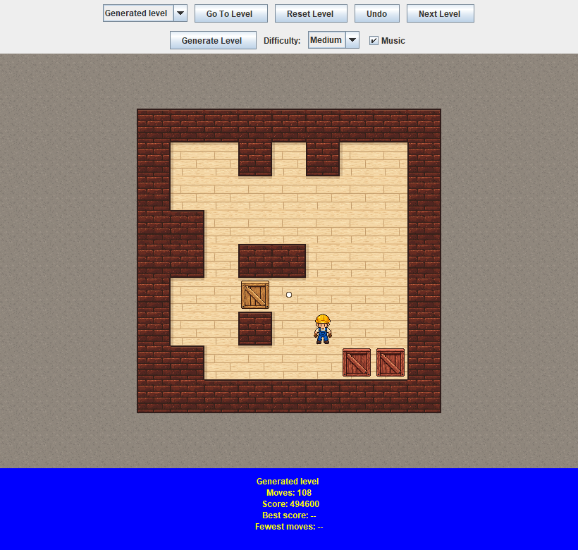
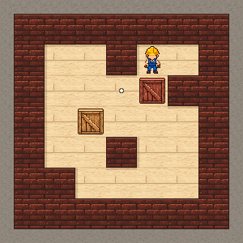
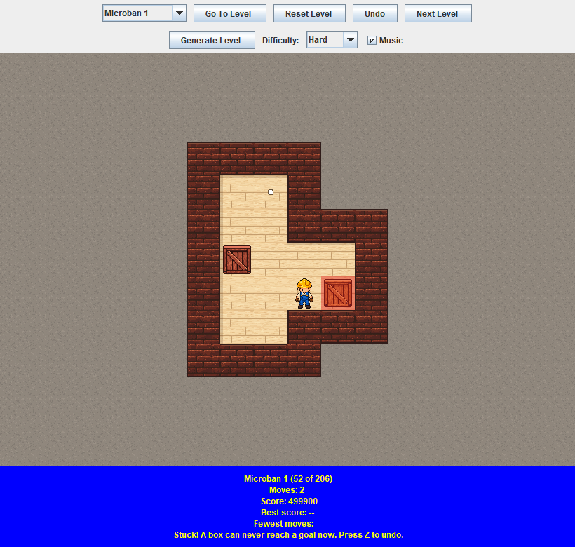

# Sokoban

A Sokoban puzzle game written in Java 21 with Swing. Push every box onto a goal
and keep your move count low.



## Features

- A title screen with Play and Quit buttons.
- 206 levels in one pool: the 51-level **Original** set followed by the 155-level **Microban** set.
- **Undo** (`Z`) takes back as many moves as you like, so you can try an idea without starting over.
- A **stuck warning**: a box that can never reach a goal again turns red and the status bar says so.
- A **level generator** with **Easy, Medium and Hard** settings. Every level it makes is guaranteed to be solvable.
- Keyboard play with WASD or the arrow keys, plus shortcuts for undo, restart, next/previous level and music.
- Scoring: every attempt starts at 500,000 points and each move on the board costs 50.
- Personal records saved between sessions: best score and fewest moves per level. The game opens on the first level you have not completed yet.
- Looping background music (with a Music box to switch it off), and a short jingle when you finish a level.
- Pixel-art warehouse artwork that scales to the window.
- Builds into a single runnable JAR file.

A generated Easy level being solved (the moves come from the solution the generator recorded):



## Requirements

To **play** the game from a JAR you only need a [JDK or JRE 21 or newer](https://adoptium.net/).
To **build** it you also need [Maven](https://maven.apache.org/), running on a **JDK** (a JRE can
run programs but cannot compile them).

Check your setup with `java -version` and `mvn -version`.

**If the terminal reports Java 1.8**, it is using Java 8. Set `JAVA_HOME` to your JDK folder,
put `%JAVA_HOME%\bin` before older Java entries in your Windows `Path`, and open a new terminal.
If `mvn` is not recognized, add Maven's `bin` folder to `Path`. Selecting a runtime inside your
IDE (for example **Java: Configure Java Runtime** in VS Code) does not change which Java the
terminal uses.

## Run and test

From the project folder:

```sh
mvn compile exec:java   # start the game
mvn test                # run the unit tests
mvn package             # run the tests and build target/sokoban.jar
```

You can also run `sokoban.Main` from your IDE after importing the Maven project. Level files
are loaded from the classpath, so the program works from any working directory.

### Playing from the JAR

`mvn package` builds **`target/sokoban.jar`**, a single file that holds the game, the levels, the
artwork, the music and the MP3 library. Copy it anywhere and start it with:

```sh
java -jar target/sokoban.jar
```

On Windows you can usually double-click it too. Your records are saved in your home folder (see
[Personal records](#personal-records)), not next to the JAR, so they survive moving or rebuilding it.

## How to play

| Action | Control |
| --- | --- |
| Move / push a box | `W` `A` `S` `D` or the arrow keys |
| Start the game from the title screen | **Play** (or press `Enter`) |
| Undo the last move (as many times as you like) | **Undo**, `Z`, `Ctrl+Z` or `Backspace` |
| Restart the level | **Reset Level** or `R` |
| Next / previous level | **Next Level** or `N` / `P` |
| Load the level chosen in the dropdown | **Go To Level** |
| Make a brand new level and play it | **Generate Level** (pick **Easy**, **Medium** or **Hard** first) |
| Turn the music on or off | **Music** box or `M` |

Hover over a button to see its shortcut.

Push boxes onto goals (`.`). Boxes can be pushed but never pulled, and only one box can be
pushed at a time. When every box is on a goal the attempt ends; press `N` for the next level, or
reset or pick another level. Blocked moves cost nothing, and the score never drops below zero.

**Undo takes the move back, and its cost with it.** The move count and score always describe the
moves that are on the board right now, so the result saved for a finished level is the length of
the solution you ended up with. A finished level is frozen: it cannot be undone (reset it instead).

The status bar at the bottom shows the current level, moves, score, and your best score and
fewest moves for that level. Completed levels are marked in the dropdown.



### Stuck warning

When a box ends up somewhere it can never reach a goal (for example a corner), it is tinted red
and the last line of the status bar says **Stuck!**. Press `Z` to undo the mistake. The warning is
careful: it only fires for boxes that really are lost, but it cannot spot every kind of
deadlock, so no warning does not guarantee a level can still be won. See
[How the stuck warning works](#how-the-stuck-warning-works) below.

### Generated levels

**Generate Level** builds a new level at the chosen difficulty and puts it at the end of the level
dropdown as "Generated level". Clicking the button again replaces it. Generated levels do not save
records, because they are not part of the level file.

| Difficulty | Room | Boxes | Typical solution |
| --- | --- | --- | --- |
| Easy | 7 x 7 | 2 | about 50 steps |
| Medium | 9 x 9 | 3 | about 115 steps |
| Hard | 11 x 10 | 5 | about 210 steps |

### Personal records

Records are loaded at startup and saved after every completion to
`%USERPROFILE%\.sokoban\progress.properties` (the `.sokoban` folder in your home directory on
other systems). Replaying a level keeps the highest score and lowest move count.
Each level collection has its own records (the Original and Microban levels are saved under their own file names). Only one local player is tracked, and unfinished
boards are not saved.

A damaged save file is reported at startup and left untouched. Level IDs are built from the
resource name and level number (for example `/original-levels.txt:3`), so reordering the levels
in a collection would require migrating its records.

## Project layout

```text
src/main/java/sokoban/          Game, window, and rendering
src/main/resources/             Level files (*.txt), sprite PNGs (sokoban/tiles/), and the music (*.mp3)
src/test/java/                  JUnit 5 tests, mirroring the main packages
docs/                           Screenshots used by this README
```

### Package `sokoban`

| Class | Responsibility |
| --- | --- |
| `Main` | Loads the levels and records, creates the shared objects, and opens the window. |
| `LevelLoader` | Reads level files. Spaces are preserved because they position tiles. |
| `Tiles` | Names for the level symbols (`#`, `$`, `@`, ...) and small helpers such as `isBox`. |
| `Direction` | The four moves (`UP`, `DOWN`, `LEFT`, `RIGHT`) as row/column offsets. |
| `BoardRules` | The rules of Sokoban as pure functions: moving, pushing, and detecting a win. |
| `State` | The shared game data: saved levels, selected level, the board being played, and the history of boards that makes undo possible. No UI or file access. |
| `GameLogic` | Applies player actions to the `State`: moving, undoing, choosing levels. Tracks completion, records results, and names every level. No Swing code. |
| `DeadlockDetector` | Finds boxes that can never reach a goal again. Pure functions on a board, no Swing code. |
| `LevelCollection` | Remembers how many levels each level file contributed, so every level gets a display name and a stable save key. |
| `PlayerProgress` / `PlayerRecord` | The player's best score and fewest moves per completed level, in memory. |
| `ProgressStore` | Saves and loads `PlayerProgress` as a properties file. |
| `GameWindow` | Builds the controls, handles input and shortcuts, calls game actions, and refreshes the display. |
| `LevelRenderer` | Draws the current board, including the red tint on stuck boxes. It only reads game data. |
| `WarehouseLayout` | Works out which squares are walls and which are outdoors, from the saved level. |
| `WarehouseSprites` | Loads the PNG artwork once and scales it to one tile size. |
| `LevelGenerator` | Makes new solvable levels by playing a finished level backwards. No Swing code. |
| `Difficulty` | The Easy, Medium and Hard recipes (room size, boxes, walls, pulls) for the generator. |
| `TitleScreen` | The opening screen with the Play and Quit buttons. |
| `SoundEffects` | Makes the level-complete jingle out of sine waves in code and plays it. |
| `BackgroundMusic` | Loops `Soboku_Music.mp3` quietly on a background thread, using the JLayer library to decode the MP3. Can be muted. |

## Architecture notes

There is **one `State` object**, created in `Main`. The game logic, window, and renderer all
receive that same instance. Do not create another `State` to read the current level: that would
create an independent game. Pass the existing instance into any new class that needs it.

Changing the state does not repaint the screen by itself. After a game action,
`GameWindow.refreshView()` updates the labels and asks Swing to repaint.
All Swing components and game-state changes run on Swing's event thread.

Fixed constants use `private static final`. Changing game data lives in `State`, never in
public static fields.

### Following a click through the code

1. The player clicks **Go To Level** in `GameWindow`.
2. The listener calls `game.selectLevel(index)`.
3. `GameLogic` updates the shared `State`, which validates the index.
4. `GameWindow.refreshView()` updates the controls and requests a repaint.
5. Swing calls `LevelRenderer.paintComponent()`, which reads that same `State`.

The dropdown is a pending choice until the button is clicked; the status line always shows the
level actually on screen. Java indices start at 0; displayed level numbers start at 1.

### How movement works

`GameWindow` binds each key to a `Direction`. `GameLogic.moveCharacter(dr, dc)` takes a row
change `dr` and a column change `dc`: up is `(-1, 0)` and right is `(0, 1)`.

`BoardRules` checks the next square before anything moves. If it holds a box, the square beyond
must be bare floor or a goal. Walls, other boxes, and the board edge block a push. A legal move
returns a new board, which `State` then adopts.

All keys, including the shortcuts, go through one helper, `GameWindow.bindKey`. A key does nothing
while the title screen is showing.

### How undo works

A move never edits the board in place: `BoardRules` returns a brand-new board. So before
`State.applyMove` switches to the new board it pushes the old one onto a stack (a `Deque`). Undo
pops the newest board off that stack and makes it the current board again. The move count is
simply the size of the stack, so taking a move back also takes back its cost, and the count and
the history can never disagree. Choosing or restarting a level empties the stack.

### Level format

Level files use the common XSB format. Consecutive lines of the symbols below make one level; any
other line (blank, title, comment) ends the level being read.

| Symbol | Meaning |
| --- | --- |
| `#` | wall |
| (space) | floor |
| `.` | goal |
| `$` | box |
| `@` | player |
| `*` | box on a goal |
| `+` | player on a goal |

Moving restores the goal underneath when a box or the player leaves it. The saved rows returned by
`State.getCurrentLevel()` never change; selecting a level copies them into a fresh board.

## How the level generator works

Making a random level and then checking whether it can be solved is hard. `LevelGenerator` avoids
the problem by building a level **backwards**, so it is solvable by construction:

1. **Build a room.** Draw an outer wall, then try to add some random walls inside. A wall is
   taken back if it would split the room in two (a breadth-first search checks this).
2. **Finish the level.** Put every box on its own goal, and the player on any free square.
3. **Undo pushes at random.** Pick a box and a direction. If the player can walk to the square
   next to the box, the box and player each step back one square, dragging the box away from its
   goal. This is exactly a Sokoban push played in reverse. Repeat many times; the more pulls, the
   more mixed up the boxes get. Pulls that are not possible (a wall is in the way, say) are skipped.
4. **Reject boring levels.** If most boxes ended up back on their goals, or the solution would be
   very short, start over.

Because every pull can be undone by a normal push, playing the pulls in reverse order solves the
level. `LevelGenerator` returns those solving moves along with the level. The game never shows
them, but `LevelGeneratorTest` replays them on the real game rules for hundreds of different
levels to prove each one can be finished.

The difficulty settings are just different numbers fed into the same recipe (see `Difficulty`):
a bigger room, more boxes and more pulls give a harder puzzle. A test checks that harder
settings really do produce longer solutions on average.

## How the stuck warning works

`DeadlockDetector` looks for two kinds of lost box. It only ever looks at the board in front of
it, and it ignores the player.

1. **A box on a dead square.** A square is *live* if a box standing on it could, in the best
   case, be pushed all the way to some goal. The detector finds the live squares by working
   **backwards from the goals** with a breadth-first search, exactly like the generator's pulls:
   a goal is live, and a square is live if a box there can be pushed onto a live square (the box
   needs a non-wall square to land on, and the player needs a non-wall square to push from).
   Other boxes are ignored, because they might be moved. Every square that never becomes live is
   dead, and a box on a dead square can never be saved. Corners are always dead, and so are squares
   along a wall that has no goal on it.
2. **A frozen block.** If a box is part of a 2 by 2 block where every square is a wall or a box,
   none of them can ever be pushed, because there is never room to stand behind one.

Both checks are *sound*: they never blame a box that can still be saved, because a lost box
is only reported when even the best possible play cannot rescue it. `DeadlockDetectorTest`
checks this by replaying generated solutions at every difficulty and confirming that no position
along the way is ever flagged, and `BundledLevelsTest` confirms none of the 206 bundled levels
starts out flagged. The detector is not *complete*: some deadlocks need cleverer checks, so
"nothing reported" does not mean "still winnable".

## Testing

`mvn test` runs the JUnit 5 tests, which cover the rules, state and undo, scoring and saved
records, level loading (including every bundled level), the generator (every generated level is
replayed to prove it can be solved), the stuck detector, and the pieces of the window that can be
tested without a display. Game rules and level generation have no Swing code, so they are tested
directly without opening a window.

## Artwork and credits

The game uses pixel sprites in `src/main/resources/sokoban/tiles/`: dark red-brown brick walls,
sandy wood planks, outdoor cement, a worker, and wooden crates. Crates turn redwood on goals.
Unfilled goals are small white dots; a player standing on a goal keeps the dot visible at their
feet. The artwork was generated with an image-generation tool, and the exact prompts are saved next
to the PNGs in `asset-prompts-terrain.txt` and `asset-prompts-entities.txt`.

`WarehouseSprites` scales every image onto a 48-pixel tile grid, and `LevelRenderer` uses
nearest-neighbor scaling so resized boards stay sharp.

The background music is `src/main/resources/Soboku_Music.mp3`. The song is mastered very loud, so
`BackgroundMusic` plays it at 25% volume (`VOLUME`); change that one constant to make it louder or
quieter. If the sound device or file is unavailable, the game runs silently.

The level-complete jingle is not a sound file: `SoundEffects` builds it from sine waves (a rising
chord of four notes), so it needs no extra assets or licenses.

The images in `docs/` are made from the game itself. The animation replays a generated level's
recorded solution.

Level collections:

- **Original**: the original Sokoban levels by Thinking Rabbit (1988), as collected at
  [Sokoban. The beautiful world of remodels](http://sokoban-jd.blogspot.com/). The first entry,
  Original 1, is a one-push warm-up that the source file describes as a modification of level 1
  made for debugging, so the classic first level is Original 2. The levels are kept as they come
  in the file because saved records are keyed by position.
- **Microban**: by David W. Skinner.

## Ideas not done yet

The original development checklist is kept in [.instructions.txt](.instructions.txt). Possible
next steps:

- Saving an unfinished board between sessions.
- A level editor.
- Mouse control (click a square to walk there).
